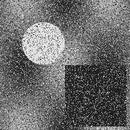
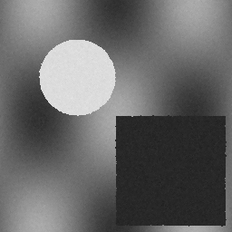
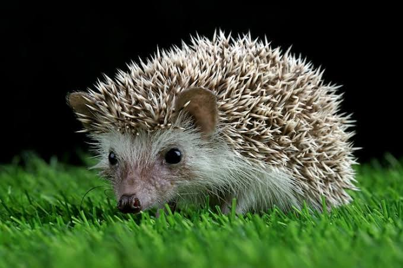
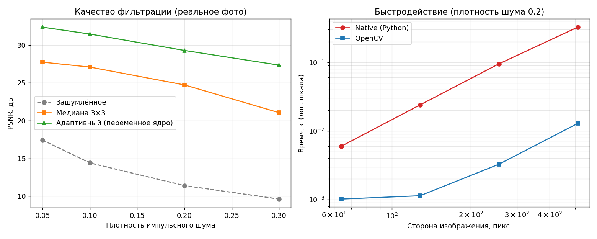
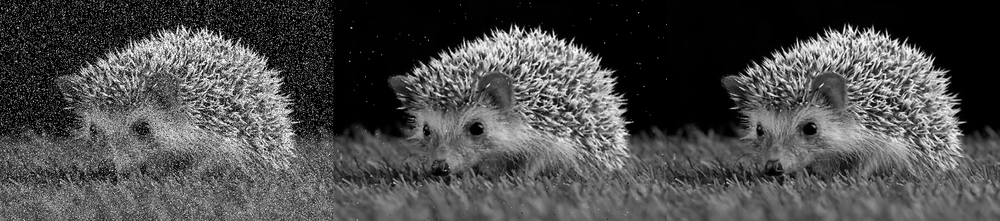

# Медианный фильтр с переменным размером ядра

## 1. Теоретическая база

Медианный фильтр заменяет значение пикселя медианой значений в окне вокруг него. Он хорошо подавляет импульсный шум («соль и перец»), сохраняя границы.

Фильтр с переменным размером ядра (адаптивный медианный фильтр) увеличивает окно, пока медиана не перестанет быть импульсом:

- `zmin`, `zmax`: минимум и максимум в окне;
- `zmed`: медиана в окне;
- `z`: значение центрального пикселя.

Алгоритм для каждого пикселя:

- **Этап A.** Если `zmin < zmed < zmax`, медиана не импульс, переходим к этапу B. Иначе увеличиваем окно (3×3 → 5×5 → 7×7). Если достигнут максимальный размер, возвращаем `zmed`.
- **Этап B.** Если `zmin < z < zmax`, пиксель не импульс, оставляем `z`. Иначе возвращаем `zmed`.

## 2. Описание разработанной системы

Проект состоит из трех файлов:

- `adaptive_median_cv.py`: вариант на OpenCV. Минимум и максимум вычисляются через `cv2.erode` и `cv2.dilate`, медиана через `cv2.medianBlur`. Всё считается векторно по маскам.
- `adaptive_median_native.py`: нативный вариант на чистом Python без numpy и OpenCV. Изображение хранится как список строк. Для каждого пикселя окно собирается и сортируется.
- `benchmark.py`: генерирует тестовое изображение 256×256, добавляет импульсный шум, запускает оба варианта, проверяет совпадение результатов и измеряет время.

Оба варианта используют репликацию границ, поэтому их результаты совпадают побитово.

Запуск: `python3 benchmark.py`, для фото — `python3 real_test.py` (зависимости: numpy, opencv-python-headless).

## 3. Результаты работы и тестирования

Синтетическое тестовое изображение: зашумлённое, адаптивный и медианный результаты:

**Качество** (изображение 256×256, плотность шума 20%, PSNR в дБ):

| Вариант | PSNR |
|---|---|
| Зашумлённое изображение | 12.24 |
| Обычный медианный фильтр 3×3 | 29.68 |
| Адаптивный фильтр (OpenCV) | 36.31 |
| Адаптивный фильтр (native) | 36.31 |

Оба варианта дали полностью одинаковый результат (0 различающихся пикселей).

**Зависимость от плотности шума** (PSNR, дБ):

| Плотность | Шум | Медиана 3×3 | Адаптивный |
|---|---|---|---|
| 0.05 | 18.09 | 37.38 | 40.39 |
| 0.10 | 15.15 | 35.70 | 38.79 |
| 0.20 | 12.23 | 29.74 | 36.96 |
| 0.30 | 10.44 | 24.04 | 34.27 |
| 0.40 | 9.17 | 18.99 | 32.79 |

Закономерность (синтетическое изображение): при росте плотности шума фиксированная медиана 3×3 деградирует быстро, адаптивный фильтр сохраняет качество заметно лучше, потому что увеличивает окно там, где это нужно.

**Быстродействие** (плотность 0.2; OpenCV: минимум из 5 запусков, native: один запуск для 512×512, минимум из 1 запуска для остальных):

| Размер | OpenCV, с | Native, с | Native / OpenCV |
|---|---|---|---|
| 64×64 | 0.00102 | 0.006 | 6.1 |
| 128×128 | 0.00114 | 0.024 | 20.6 |
| 256×256 | 0.00328 | 0.095 | 29.1 |
| 512×512 | 0.01288 | 0.325 | 25.3 |

Закономерность: вариант на OpenCV быстрее нативного в 6–30 раз. Разрыв растёт с размером изображения, так как векторные операции OpenCV масштабируются лучше построчных циклов Python. Абсолютные значения зависят от машины.

### Тест на реальном изображении (ёж, 679×452, оттенки серого)

Исходное изображение: `images/source_photo.jpeg`.

Эталоном PSNR служит исходное полутоновое изображение. Импульсный шум добавлен искусственно.

**Качество** (PSNR, дБ):

| Плотность | Шум | Медиана 3×3 | Адаптивный |
|---|---|---|---|
| 0.05 | 17.42 | 27.73 | 32.36 |
| 0.10 | 14.40 | 27.08 | 31.45 |
| 0.20 | 11.40 | 24.72 | 29.28 |
| 0.30 | 9.62 | 21.05 | 27.34 |

Вариант на OpenCV и нативный дают идентичный результат (0 различающихся пикселей при плотности 0.2).

**Скорость** (плотность 0.2): OpenCV 0.0153 с, native 0.535 с, отношение 34.9.

Сравнение (слева направо: зашумлённое 0.2, медиана 3×3, адаптивный):

## 4. Выводы

1. Адаптивный медианный фильтр заметно лучше фиксированной медианы при импульсном шуме, особенно при высокой плотности. Выигрыш составил около 6–14 дБ на синтетическом изображении и около 5–6 дБ на реальном фото.
2. Реализация на OpenCV и нативная реализация дают одинаковый результат. Это подтверждает корректность обеих.
3. Нативный вариант на Python в 25–35 раз медленнее OpenCV на изображениях от 256×256 (включая реальное фото). Для практических задач стоит использовать векторизованные библиотеки.

## 5. Использованные источники

1. Gonzalez R. C., Woods R. E. *Digital Image Processing*. Pearson. Раздел про адаптивный медианный фильтр.
2. Клод код
3. Какой то индус на ютубе
